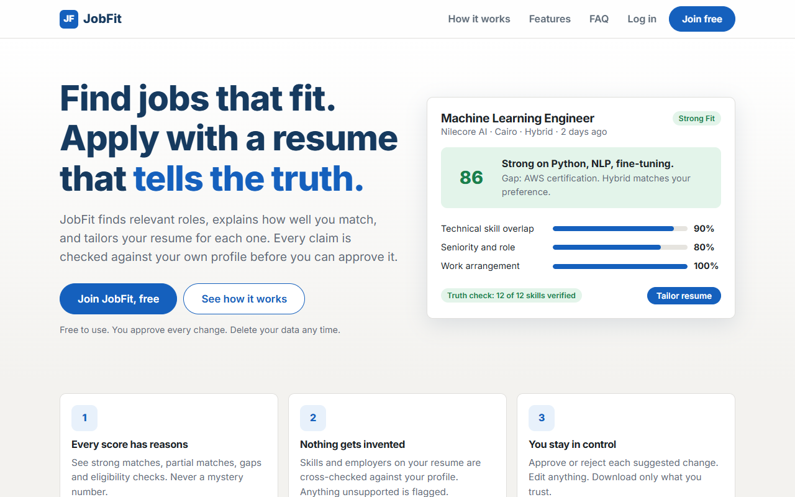
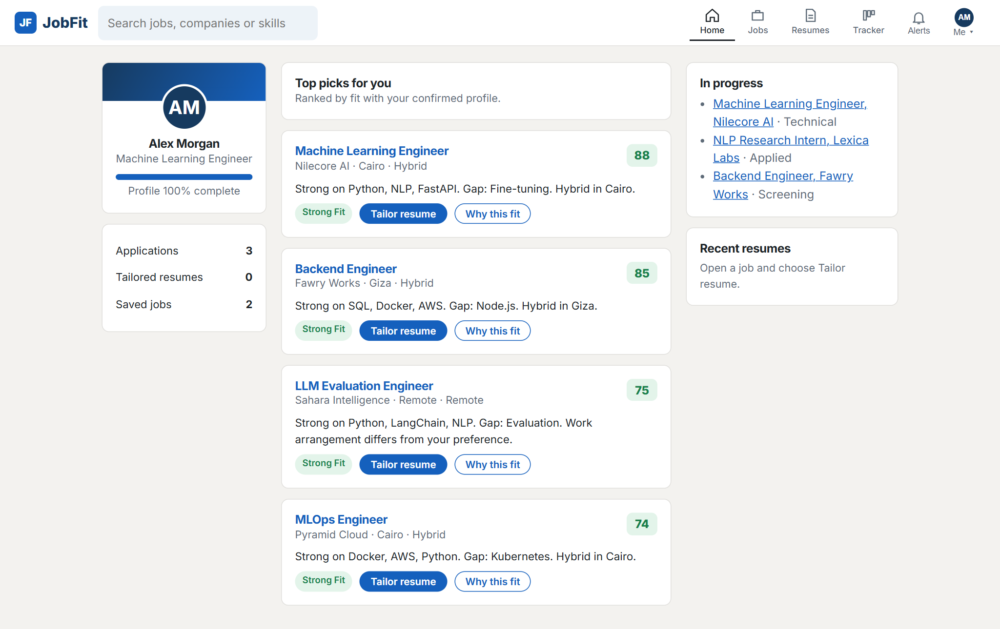
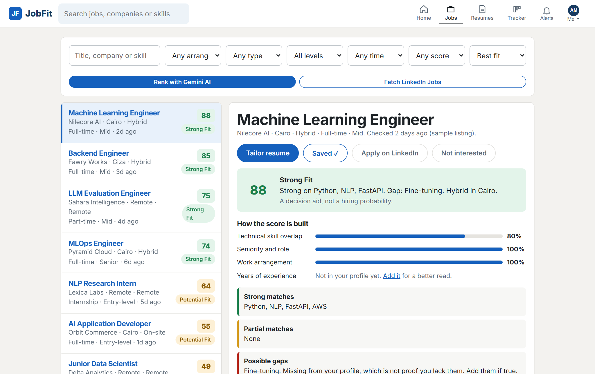
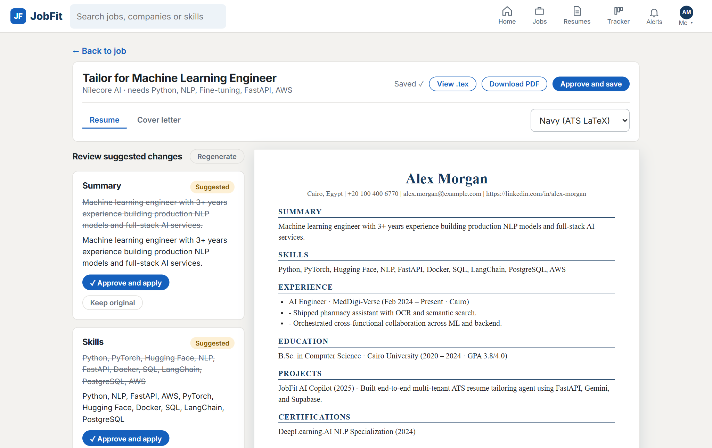
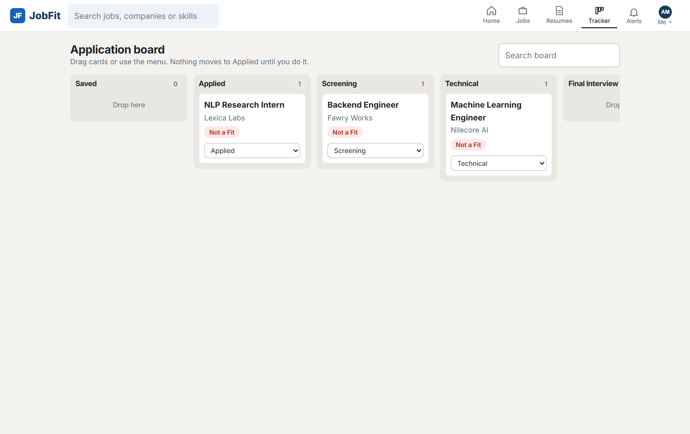
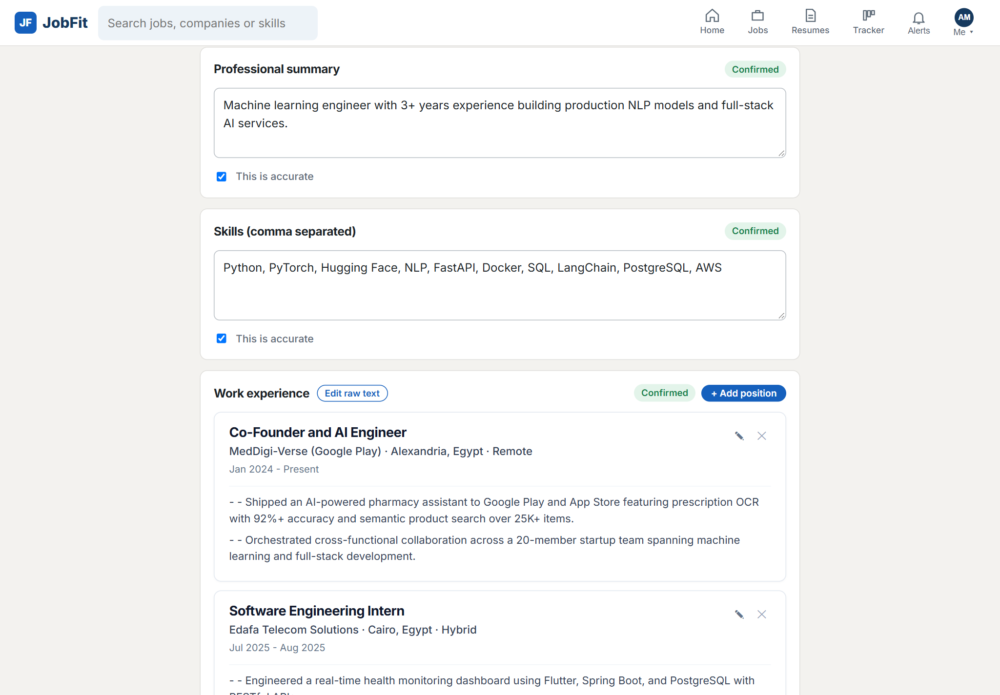
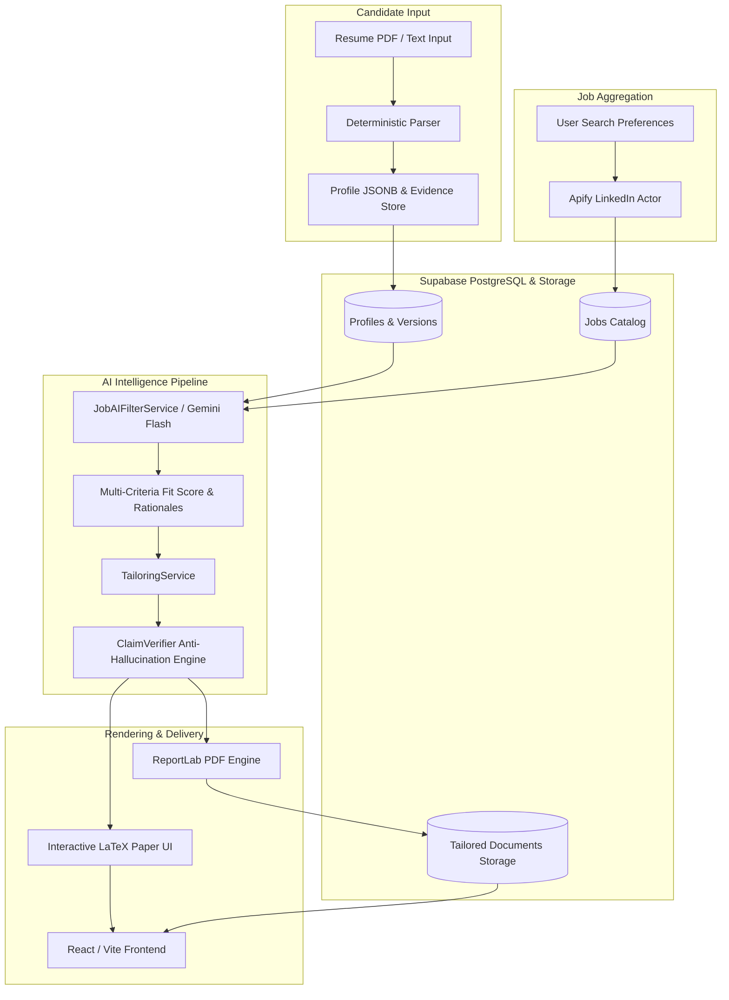

# JobFit: Autonomous AI Career Copilot & ATS Resume Tailoring Engine

An enterprise-grade, privacy-first career intelligence platform designed to autonomously discover live job openings, rank opportunities using multi-criteria AI evaluations, and generate tailored, ATS-compliant resumes with mathematical anti-hallucination guarantees.

**Developed by:** Mahmoud El-Sherbiny & Abdullah El-Sherbiny

---

## Table of Contents

- [Overview](#overview)
- [Key Features](#key-features)
- [User Interface & Visual Tour](#user-interface--visual-tour)
  - [Landing Page & Real-Time Fit Analysis](#landing-page--real-time-fit-analysis)
  - [Candidate Intelligence Dashboard](#candidate-intelligence-dashboard)
  - [Live Job Discovery & Gemini AI Ranking](#live-job-discovery--gemini-ai-ranking)
  - [ATS Resume Tailoring & LaTeX Typography](#ats-resume-tailoring--latex-typography)
  - [Application Lifecycle Kanban Board](#application-lifecycle-kanban-board)
  - [Profile & Evidence Management](#profile--evidence-management)
- [System Architecture](#system-architecture)
- [Tech Stack](#tech-stack)
- [Prerequisites](#prerequisites)
- [Setup & Installation](#setup--installation)
  - [1. Clone Repository](#1-clone-repository)
  - [2. Supabase Configuration](#2-supabase-configuration)
  - [3. Backend Setup & Secrets Configuration](#3-backend-setup--secrets-configuration)
  - [4. Frontend Setup](#4-frontend-setup)
- [Configuration & Secrets Reference](#configuration--secrets-reference)
- [Running the Application](#running-the-application)
- [Verification & Quality Assurance](#verification--quality-assurance)
- [Project Directory Structure](#project-directory-structure)
- [Security & Candidate Privacy](#security--candidate-privacy)
- [Authors & Credits](#authors--credits)
- [License](#license)

---

## Overview

Applying for jobs in technical sectors is broken. Candidates spend hours tailoring resumes manually or use naive generative AI tools that fabricate experiences, leading to disqualification or interview failure.

JobFit solves this by creating a closed-loop copilot:
1. **Live Discovery**: Pulls authentic LinkedIn listings through optimized Apify scraper pipelines.
2. **Transparent Scoring**: Evaluates candidate fit across technical overlap, seniority, and work preferences using Gemini Flash, complete with recruiter rationales.
3. **Factual Tailoring**: Aligns resume bullets to target roles while enforcing a strict zero-hallucination ClaimVerifier that blocks unverified claims.
4. **Publishing-Grade Typography**: Renders ATS-scannable documents conforming to LaTeX typography standards in both browser preview and downloadable PDFs.

---

## Key Features

- **Deterministic Resume Parser**: Replaces unreliable LLM-based extraction with a deterministic state machine that accurately splits sections, extracts contact details (including international prefixes and regional LinkedIn subdomains), and parses multi-line employment entries.
- **Anti-Hallucination ClaimVerifier**: Every tailored bullet is cross-referenced against the candidate's verified profile evidence. If a skill, employer, or metric cannot be grounded in source data, it is flagged and blocked until cleared.
- **Multi-Criteria Job Matching**: Generates fit scores (0-100) combining technical skill overlap, seniority level, and workplace arrangements (Remote, Hybrid, On-site).
- **Dual Document Rendering**:
  - *Browser Canvas*: Interactive LaTeX-style paper preview with side-by-side diff approvals and direct `.tex` export.
  - *PDF Engine*: High-fidelity ReportLab renderer generating ATS-compliant, publication-ready documents.
- **Multi-Tenant User Isolation**: Strict tenant scoping across all Supabase PostgreSQL tables and Row Level Security (RLS) policies on user document buckets.
- **Interactive Kanban Pipeline**: Drag-and-drop tracker managing applications through Saved, Applied, Screening, Technical, Final Interview, and Offer stages.

---

## User Interface & Visual Tour

### Landing Page & Real-Time Fit Analysis
Presents the candidate value proposition, explaining fit score breakdowns, verification safeguards, and ATS alignment.



---

### Candidate Intelligence Dashboard
Aggregates top AI-ranked jobs, profile completeness metrics, pipeline statistics, and recent application activity.



---

### Live Job Discovery & Gemini AI Ranking
Allows multi-faceted filtering across role titles, workplace type, seniority levels, posting dates, and fit scores. Direct integration with Google Gemini provides transparent recruiter rationales and gap analyses.



---

### ATS Resume Tailoring & LaTeX Typography
Presents proposed resume adjustments with granular accept/reject controls alongside a live LaTeX paper preview. Supports instant `.tex` source export and ATS-optimized PDF generation.



---

### Application Lifecycle Kanban Board
Enables full visibility into the hiring process. Candidates can track active submissions and associate tailored resumes with specific job cards.



---

### Profile & Evidence Management
Maintains confirmed candidate credentials, extracted contact information, and verified skills that serve as the single source of truth for all tailoring operations.



---

## System Architecture



---

## Tech Stack

| Layer | Technologies |
|---|---|
| **Backend** | Python 3.12, FastAPI, Uvicorn, Pydantic v2, PyPDF, ReportLab |
| **Database & Auth** | Supabase (PostgreSQL, Supabase Auth, Row-Level Security, Storage Buckets) |
| **Artificial Intelligence** | Google Gemini SDK (`gemini-2.5-flash` / `gemini-3.5-flash-lite`), LangChain primitives |
| **External Integrations** | Apify LinkedIn Scraper Actor (`curious_coder/linkedin-jobs-scraper`) |
| **Frontend** | React 18, TypeScript, Vite, React Router v7, Vanilla CSS design system |
| **Testing & Tooling** | Pytest, Ruff, Playwright, UV package manager |

---

## Prerequisites

Before running the project locally, ensure you have:

- **Python**: Version 3.12 or newer.
- **UV**: Fast Python package manager ([installation instructions](https://github.com/astral-sh/uv)).
- **Node.js**: Version 18.x or newer (with `npm`).
- **Supabase Account**: A free cloud project at [supabase.com](https://supabase.com).
- **Google AI Studio Account**: API key for Google Gemini models from [aistudio.google.com](https://aistudio.google.com).
- **Apify Account (Optional)**: API token from [apify.com](https://apify.com) for running live LinkedIn job scrapers.

---

## Setup & Installation

### 1. Clone Repository

```bash
git clone https://github.com/your-username/job-agent.git
cd job-agent
```

---

### 2. Supabase Configuration

1. Create a new project in the Supabase Dashboard.
2. In the **SQL Editor**, execute the migration scripts located in `backend/supabase/migrations/` in sequential order to set up tables:
   - `profiles`
   - `profile_versions`
   - `profile_evidence`
   - `jobs`
   - `job_matches`
   - `tailored_documents`
   - `applications`
   - `search_preferences`
3. In **Storage**, create two buckets:
   - `resumes` (Private, candidate uploaded resumes)
   - `tailored-documents` (Private, generated PDFs and LaTeX artifacts)
4. Ensure Row Level Security (RLS) is enabled on all tables and storage buckets as defined in the migrations.

---

### 3. Backend Setup & Secrets Configuration

1. Navigate to the `backend` directory:
   ```bash
   cd backend
   ```
2. Copy the example environment file:
   ```bash
   cp .env.example .env
   ```
3. Populate `.env` with your credentials:
   ```ini
   ENVIRONMENT=development
   LOG_LEVEL=INFO
   APP_VERSION=0.1.0
   SECRET_KEY=dev-secret-key-change-in-production-min-32-chars-long
   ALLOWED_ORIGINS=http://localhost:3000,http://localhost:5173

   # Supabase Configuration
   SUPABASE_URL=https://<your-project-id>.supabase.co
   SUPABASE_ANON_KEY=<your-supabase-anon-key>
   SUPABASE_SERVICE_ROLE_KEY=<your-supabase-service-role-key>
   SUPABASE_JWT_SECRET=<your-supabase-jwt-secret>

   # Gemini API Key
   GEMINI_API_KEY=<your-google-gemini-api-key>
   LLM_MODEL=gemini-2.5-flash
   LLM_PROVIDER=gemini

   # Apify Integration (for live LinkedIn job scraping)
   APIFY_API_TOKEN=<your-apify-api-token>
   APIFY_ACTOR_ID=curious_coder~linkedin-jobs-scraper
   ```
4. Install backend dependencies using `uv`:
   ```bash
   uv sync
   ```

---

### 4. Frontend Setup

1. Open a new terminal and navigate to the `frontend` directory:
   ```bash
   cd frontend
   ```
2. Install dependencies:
   ```bash
   npm install
   ```
3. The frontend Vite configuration proxies API calls to `http://127.0.0.1:8000`, so no extra frontend `.env` file is required for local execution.

---

## Configuration & Secrets Reference

| Secret Variable | Description | Where to Obtain |
|---|---|---|
| `SUPABASE_URL` | Base API URL of your Supabase project | Supabase Dashboard > Project Settings > API |
| `SUPABASE_ANON_KEY` | Public anonymous key for client requests | Supabase Dashboard > Project Settings > API |
| `SUPABASE_SERVICE_ROLE_KEY` | Administrative service-role key for backend operations | Supabase Dashboard > Project Settings > API |
| `SUPABASE_JWT_SECRET` | Secret key used to decode and verify Supabase Auth tokens | Supabase Dashboard > Project Settings > API > JWT Settings |
| `GEMINI_API_KEY` | API key for Gemini Flash models | Google AI Studio (`https://aistudio.google.com`) |
| `LLM_MODEL` | Default LLM identifier (recommended: `gemini-2.5-flash`) | Google Gemini Model Directory |
| `APIFY_API_TOKEN` | API token for running external LinkedIn scraping actors | Apify Console > Settings > Integrations |
| `APIFY_ACTOR_ID` | Actor identifier (`curious_coder~linkedin-jobs-scraper`) | Apify Store |
| `SECRET_KEY` | 32-character secret string for internal signature generation | Self-generated random alphanumeric string |

---

## Running the Application

### 1. Launch the Backend API

From the `backend` directory:
```bash
uv run uvicorn app.main:create_app --factory --reload --port 8000
```
The FastAPI documentation will be available at:
- Swagger UI: `http://127.0.0.1:8000/docs`
- Health check: `http://127.0.0.1:8000/api/v1/health`

### 2. Launch the Frontend Development Server

From the `frontend` directory:
```bash
npm run dev
```
Open your browser and navigate to:
```
http://localhost:5173
```

---

## Verification & Quality Assurance

### Run Backend Unit Tests

Execute the comprehensive test suite verifying the deterministic parser, ClaimVerifier, and routing endpoints:
```bash
cd backend
uv run pytest tests/unit/
```
All 208 unit tests must pass without warnings.

### Run Frontend Typecheck and Build

Verify TypeScript compilation and asset bundling:
```bash
cd frontend
npm run build
```

---

## Project Directory Structure

```
job-agent/
├── backend/
│   ├── app/
│   │   ├── api/v1/routes/        # FastAPI endpoint handlers (auth, jobs, profile, tailor)
│   │   ├── core/                 # Config, security, database connectors
│   │   ├── models/               # SQLAlchemy and Supabase database models
│   │   ├── providers/            # External integration clients (Apify, Gemini)
│   │   ├── repositories/         # Scoped data access objects
│   │   ├── schemas/              # Pydantic validation schemas
│   │   └── services/             # Core business logic (tailoring, parsing, verification)
│   ├── docs/                     # Architecture and technical specifications
│   ├── supabase/migrations/      # PostgreSQL migrations and RLS policies
│   ├── tests/                    # Unit and integration test suites
│   ├── .env.example              # Environment variables template
│   └── pyproject.toml            # Backend dependencies and project manifest
├── docs/
│   └── screenshots/              # High-resolution application screenshots
├── frontend/
│   ├── src/
│   │   ├── components/           # Reusable UI components (Shell, AppLayout, Logo)
│   │   ├── lib/                  # Parser utilities, matching math, ATS layout engine
│   │   ├── pages/                # Page views (Landing, Dashboard, Jobs, Tailor, Tracker)
│   │   ├── store/                # React context state management
│   │   ├── api.ts                # Backend API client
│   │   └── types.ts              # TypeScript domain types
│   ├── package.json              # Frontend dependencies
│   └── vite.config.ts            # Vite bundler configuration and API proxy
└── README.md                     # Comprehensive project documentation
```

---

## Security & Candidate Privacy

- **No Data Fabrication**: The ClaimVerifier explicitly rejects hallucinated skills or non-grounded claims before saving or rendering documents.
- **Tenant Isolation**: Every database interaction filters by the authenticated user's ID. Multi-tenant leakages are prevented at the database query level.
- **Time-Limited Signed URLs**: Resumes and tailored PDFs stored in Supabase Storage are accessed through signed, time-limited URLs that expire automatically after 3,600 seconds.
- **Self-Service Erasure**: Candidates retain full ownership of their data and can purge their profiles, resumes, and application records at any time.

---

## Authors & Credits

Designed and engineered by:
- **Mahmoud El-Sherbiny**
- **Abdullah El-Sherbiny**

---

## License

This project is licensed under the MIT License. See the [LICENSE](LICENSE) file for details.
